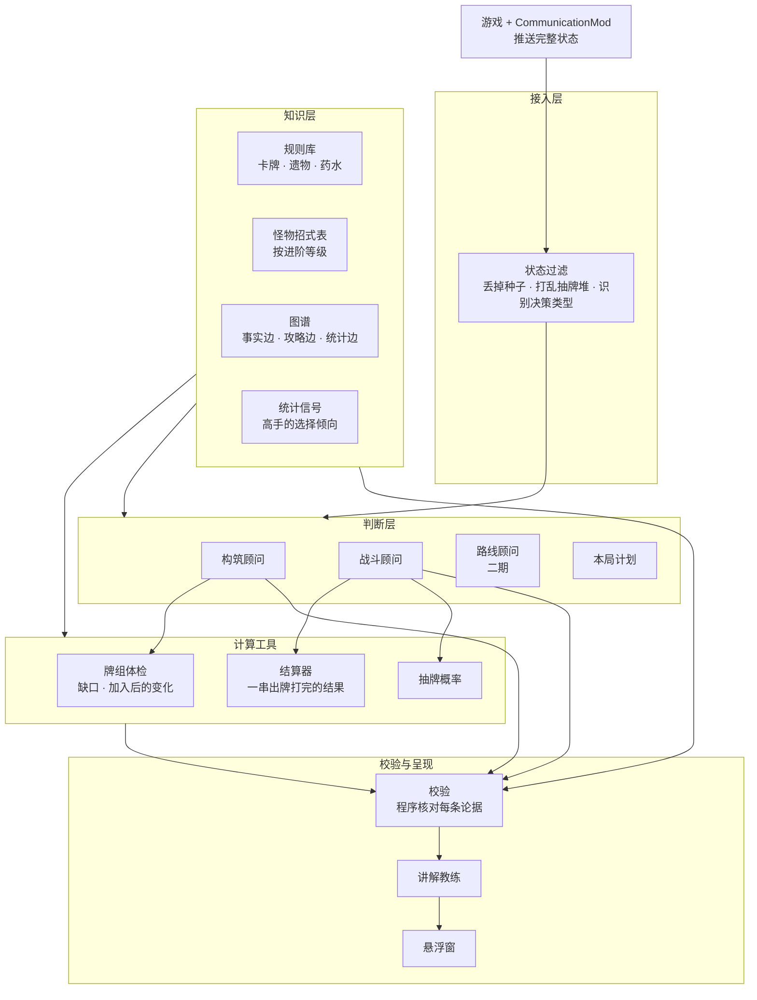
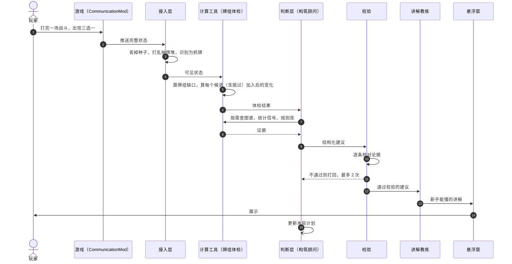
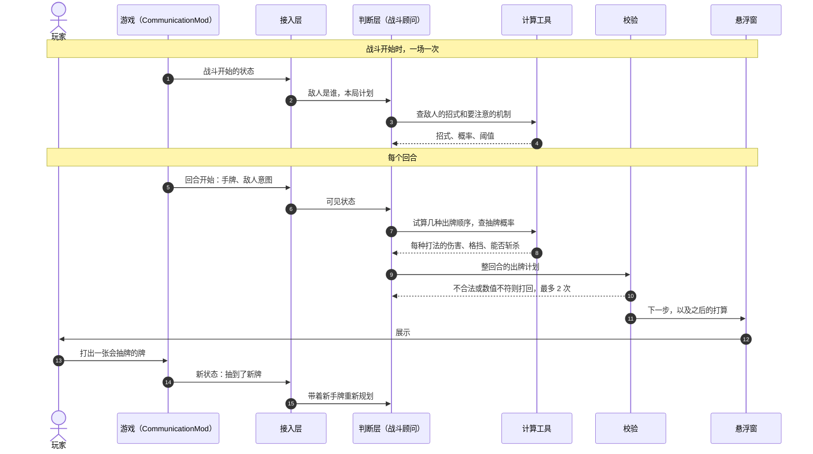

# 杀戮尖塔局内助手 v2 方案（含 v1 复盘）

这是《杀戮尖塔》一代的局内助手：玩家打游戏时，它在抓牌、篝火、战斗出牌等决策点给建议，并用新手听得懂的话解释为什么。判断、规划和讲解交给 LLM；算术由程序做成工具供 LLM 调用；LLM 说的每句话由程序核对。

本文只管 v2 的整体设计和 v1 的复盘。界面细节另写界面 PRD。

**当前状态**：v1 已实现并可运行，是一个规则打分器。v2 处于设计阶段，本文所有 v2 内容都是计划，没有实测结果。文中的外部研究数字都标了出处，其中来自二手摘要的另有说明（见「参考资料」）。

## 目标

| 视角 | 目标 |
| --- | --- |
| 用户 | 新手玩家。在一局游戏的关键决策点拿到建议，并看懂为什么 |
| 作品 | 面试作品。每个设计取舍有依据，每个效果声明要么有数字，要么明说还没测 |
| 本次范围 | 只给建议，不代打。抓牌、篝火、战斗出牌四个角色都能用；评测先做铁甲战士（Ironclad），其他角色的建议标明「未评测」；进阶等级只做 0。注：路线、商店、Boss 遗物、药水放第二期，事件放第三期；代打、高进阶、跨局记忆、多回合模拟搜索归到新功能，本次不做 |
| 公平边界 | 运行时只用玩家屏幕上看得到的信息。种子只在离线构建和评测时用 |
| v1 的去向 | 在同一个仓库里重建。v1 的代码已从主分支删除，完整保留在标签 `v1`（提交 `11c5c69`）里；新代码在 `sts_advisor/` |

## 一局游戏有哪些决策

一局游戏分 3 幕（集齐三把钥匙有第 4 幕），每幕 15 层地图加一个 Boss。地图节点有 7 种：怪物、精英、篝火、商店、问号房、宝箱、Boss。玩家从头到尾要做的决策如下。

| 决策点 | 玩家要定什么 | 能算出来的 | 需要判断的 | 分期 |
| --- | --- | --- | --- | --- |
| 战斗出牌 | 这回合打哪些牌、什么顺序、打谁、用不用药水 | 一串出牌的伤害与格挡、能否斩杀、敌人之后可能的招式 | 这场该抢血还是拖成长，药水留不留 | 一期 |
| 抓牌 | 战斗后三选一，或者跳过 | 牌组的缺口、加入后的变化、牌组变厚的代价 | 眼前和长远怎么权衡 | 一期 |
| 篝火 | 休息，还是升级哪张牌 | 回多少血、升级后的数值变化 | 血量够不够撑到下一个篝火 | 一期 |
| 路线 | 走哪条路 | 每条路的节点构成、问号房的概率 | 打几个精英、什么时候进商店 | 二期 |
| 商店 | 买什么、删哪张牌 | 价格、删牌涨价 | 钱花在哪 | 二期 |
| Boss 遗物 | 三选一，或者跳过 | 遗物的硬限制和牌组冲不冲突 | 代价值不值 | 二期 |
| 药水 | 什么时候用 | 用了之后战斗结果的变化 | 留给哪一场 | 二期 |
| 事件 | 选哪个选项 | 各选项的确定结果 | 风险取舍 | 三期 |

这张表决定了整个架构的分工：「能算出来的」一列由程序做成工具，「需要判断的」一列归 LLM，LLM 判断时调用这些工具。

## v1 复盘

v1 有三样东西：核心思想（作者脑子里的）、设计文档、仓库代码。复盘的主要发现是这三样互不相同。

**三方现状对表**

| 能力 | 核心思想 | v1 设计文档 | v1 仓库 | v2 目标 |
| --- | --- | --- | --- | --- |
| 高手对局数据 | 爬取高手的抓牌 | 只当评测集来源 | 没有 | 以「每一次选择」为单位做统计信号（改动点 5） |
| 卡牌关系的来源 | 共现统计 | 人工定义的语义关系 | 对页面文字做关键词匹配。606 条卡牌边里 599 条是「卡 → 标签」 | 规则推出的事实边、抽取的攻略边、统计边，分开标注（改动点 4） |
| 流派 | 由共现算出 | Archetype 节点 | 20 条手写规则：持有 A 就给 B 加分 | 聚类得出，只作描述标签，不加分 |
| 抓牌打分 | 靠图谱关系 | 四个 LLM Agent 串行 | 稀有度底分加共享标签加分 | 牌组体检找缺口，再交给判断层（改动点 6、8） |
| LLM | 没提 | 四个 Agent | 决策链路里没有调用，只有一个离线抽取脚本 | 判断、定战斗目标、讲解（改动点 8） |
| 条件分支 | 没提 | Critic 否决后走条件边 | 5 个节点线性连接，没有条件边 | 校验不通过时打回或降级（改动点 9） |
| 战斗 | 用卡组和意图算最优解 | 没有 | 单回合组合枚举，用正则抓数字 | LLM 规划整回合出牌，调用结算工具（改动点 7） |
| 状态接入 | 没提 | 手填的状态结构 | 读自拟的扁平 JSON | 接 CommunicationMod 的真实结构并过滤（改动点 1） |
| 评测 | 没提 | 120 个专家断面、一张消融表 | 23 个手写用例，和打分规则同一人写、一一对应；没有基线 | 分层指标加真实基线（改动点 11） |

结论：

1. 核心思想是「统计共现图」，设计文档是「人工语义图加 LLM 辩论」，仓库是「标签表加手写加分规则」。三者是三套东西。
2. 设计文档里的消融表和 120 个专家断面，在仓库里没有对应的代码或数据。v2 不沿用这些内容。
3. 仓库的决策链路里没有 LLM，也没有条件分支，不能称为多 Agent 系统。
4. 数据层不可用：遗物的效果文本没有抓到，卡牌关系来自关键词匹配。
5. 评测用例和打分规则同源，一致率高不说明系统有效。

**v1 仓库的具体缺陷**

下表按代码手推得出，没有实际运行仓库脚本。

| 缺陷 | 证据 | 后果 | v2 对应 |
| --- | --- | --- | --- |
| 共享标签加分随重复张数叠加 | `scoring.py` 的 `_synergy_weight`，`knowledge_base.py` 的 `find_synergies` | 初始牌组的 5 张打击加 1 张痛击，会让任何攻击牌拿到约 +70 分并封顶 100 | 改动点 6 |
| 冗余惩罚不生效 | `tags_for_ids` 先去重，`_redundancy_penalty` 却要求计数达到 5 | 同类牌再多也不扣分 | 改动点 6 |
| 「跳过」不可能被推荐 | 输入 `Skip` 被解析成商店动作，在抓牌里判为非法并扣 60 分 | 助手永远劝人拿牌 | 改动点 6 |
| 底分基本等于稀有度 | 初始牌 42、普通 55、罕见 63、稀有 72 到 75 | 稀有牌默认更值得拿 | 改动点 6 |
| 多个状态字段没被读取 | Boss、地图、进阶等级、升级标记、抽牌堆、弃牌堆 | 建议不随局势变化 | 改动点 1 |
| 牌名解析会静默丢牌 | `resolve_many` 解析不到就跳过，`Bash+` 和中文牌名都解析不到 | 牌组被悄悄缩小 | 改动点 2 |
| 遗物效果缺失 | 146 个遗物的 `description` 全是稀有度名 | 遗物联动无从谈起 | 改动点 2 |
| 关键词匹配打错标签 | 天鹅绒项圈（Velvet Choker）带 `shiv` 标签，死灵之书（Necronomicon）带 `orb_dark` 标签 | 冲突被当成协同 | 改动点 4 |
| 战斗只做单回合粗估 | `combat.py`：不排出牌顺序，不算易伤、力量、多段攻击和敌人能力，X 费按 1 费算 | 对地精大块头（Gremlin Nob）会推荐连打防御牌 | 改动点 7 |

**v1 设计层面的问题**

即使把 v1 设计文档完整实现，下面四个问题仍然存在。

- 图谱编码的是流派思维。协同是定量的、依赖上下文的（有几张、几费、抽不抽得到），一条「强协同」的边表达不了。
- Critic 是单向否决。没有角色负责指出「这样太保守」，而过度保守正是 LLM 打这个游戏时被测出来的系统性偏差（见设计原则 5）。
- 六维评分让 LLM 估。这些数应该算出来。
- 评测指标是「与专家选择的一致率」。高手之间对同一件遗物的评级会相反，这个指标没有稳定的标准答案。

**v1 各部件的去向**

决定词只用：保留 / 去掉 / 并入 / 替代。标「保留」的部件，代码在标签 `v1` 里，用到时取回。

| 部件 | 决定 | 理由 |
| --- | --- | --- |
| FastAPI 加 WebSocket 的桥接、网页悬浮窗 | 保留 | 与打分逻辑无关，可直接复用 |
| 数据来源标注字段（source、confidence） | 保留 | v2 的三类边需要分开标来源 |
| 没有 LLM 或图数据库时可降级 | 保留 | v2 的降级路径沿用这个思路 |
| LangGraph 状态图 | 保留 | 框架保留，节点全部重写 |
| Neo4j 导入脚本加本地 JSON 回退 | 保留 | 图的规模是千级节点，本地回退足够日常开发 |
| 评测脚本的壳 | 保留 | 用例全部替代 |
| wiki 抓取加关键词匹配 | 替代 | 换成游戏本体数据（改动点 2） |
| 稀有度底分加共享标签加分 | 去掉 | 见上面的缺陷表 |
| 手写流派加分规则 | 去掉 | 流派改为描述标签，不参与打分 |
| `combat.py` | 替代 | 换成 LLM 规划加结算工具（改动点 7） |
| 自拟 JSON 适配器 | 替代 | 换成真实结构的接入层（改动点 1） |
| 设计文档的六维体检 | 并入 | 并入牌组体检，改为计算（改动点 6） |
| Critic 单向否决 | 替代 | 换成双向检查加程序校验（改动点 8、9） |
| 120 个专家断面、消融表 | 去掉 | 没有来源 |

**从 v1 学到的**

- 先核对「想的、写的、做的」是不是同一个东西，再谈优化。
- 评测用例不能和被测的规则出自同一批想法，否则只是在验证自己。
- 文档里的每个效果声明都要能指到一段代码或一份数据，指不到就删。

## 设计原则

| 原则 | 意思 | 为什么 |
| --- | --- | --- |
| 1 · 算术交给工具，LLM 不心算 | 结算、合法性、概率由程序做成工具；LLM 负责规划和取舍 | 数值和规则细节是 LLM 最容易出错的地方；工具的结果可以核对 |
| 2 · LLM 做判断和讲解，且必须带出处 | LLM 的每条论据要引用具体的牌、遗物、数值 | 出处能被程序核对，没有出处的话不展示 |
| 3 · 只用玩家看得到的信息 | 运行时不读种子，不读抽牌堆的真实顺序 | CommunicationMod 默认会给这两样，用了就是透视，建议也就不可学 |
| 4 · 先看缺口，再谈流派 | 抓牌先问「这副牌接下来过不过得去」，流派只作描述 | 高手社区的共识是流派是事后的描述，不是事前的目标 |
| 5 · 太贪和太怂都要查 | 每条建议同时检查两个方向 | SpireBench 测到 LLM 在第一幕篝火选休息的比例是 68%，人类是 23%，顶尖主播是 9% |
| 6 · 没测过的不写成结论 | 文档和简历里只写跑出来的数字 | v1 文档的教训 |
| 7 · 加角色不重写 | 规则库四个角色一次导出；结算器复用现成的四角色计算模块 | 新手会玩不同的角色，加角色的成本要低 |

## 产品架构

**五层结构**

箭头从判断层指向计算工具，表示 Agent 调用工具。

| 层 | 职责 | 用不用 LLM | 延迟目标 |
| --- | --- | --- | --- |
| 接入层 | 把游戏状态变成「可见状态」，识别当前是哪种决策 | 不用 | 毫秒级 |
| 知识层 | 存事实：牌和遗物的效果、怪物招式、关系、统计 | 运行时不用；离线抽取攻略时用 | 查询毫秒级 |
| 计算工具 | 算：牌组缺什么，一串出牌打完是什么结果，抽到某张牌的概率 | 不用 | 单次调用毫秒级 |
| 判断层 | 判断和规划：抓牌怎么取舍，这回合怎么出牌，维护本局计划 | 用 | 非战斗 10 秒内，战斗每次建议 5 秒内 |
| 校验与呈现 | 核对 LLM 的话，翻成新手能懂的讲解，展示 | 校验不用；讲解用 | 含在判断层的时间里 |

延迟目标是设计值，没有实测。

## 核心对象

| 对象 | 是什么 | 归属 | 关系 |
| --- | --- | --- | --- |
| 原始状态 | 游戏推送的完整状态，含种子和抽牌堆的真实顺序 | 接入层 | 只在接入层内部存在，不向下传 |
| 可见状态 | 过滤后的状态，只含玩家屏幕上有的信息 | 接入层 | 每次游戏状态稳定时生成一份，其他层只读 |
| 规则库 | 卡牌、遗物、药水的效果数据 | 知识层 | 校验、讲解、图谱共用同一份 |
| 怪物招式表 | 每个敌人的招式、选招规则、阈值 | 知识层 | 战斗顾问通过查询工具读它 |
| 图谱 | 实体之间带类型的关系 | 知识层 | 事实边由规则库和招式表自动生成 |
| 统计信号 | 高手在某类局面下的选择倾向 | 知识层 | 以统计边的形式挂在图谱上 |
| 体检结果 | 牌组在 8 项能力上的数值、缺口、各候选的变化 | 计算工具 | 每次非战斗决策前算一次 |
| 战斗目标 | 这场战斗的打法：血量预算、药水留不留、要注意的机制 | 判断层 | 战斗顾问在战斗开始时写，之后每回合自己读 |
| 本局计划 | 这一局的整体打算：缺口、Boss 约束、血量预算 | 判断层 | 一局一份，所有 Agent 读 |
| 建议 | 结构化结论：推荐项、论据、风险 | 判断层 | 每条论据带实体编号和数值 |
| 校验结果 | 每条论据通过与否 | 校验与呈现 | 不通过的打回或删掉 |
| 讲解 | 展示给玩家的文字 | 校验与呈现 | 只由通过校验的论据生成 |

## 关键流程

**流程一：抓牌建议**

| 步骤 | 说明 |
| --- | --- |
| 3 | 公平边界在这一步落地，见改动点 1 |
| 5 | 「跳过」是一个正式候选，变化为零 |
| 7 | 查什么、查几次由构筑顾问自己决定 |
| 11 | 打回 2 次仍不通过，就只展示体检结果，不给 LLM 的结论 |

**流程二：战斗中的一回合，以及抽牌后重新规划**

| 步骤 | 说明 |
| --- | --- |
| 3、4 | 战斗顾问据此写下这场的战斗目标，之后每回合自己读 |
| 7 | 试算几次由战斗顾问自己决定 |
| 10 | 打回 2 次仍不通过，就只展示结算器算出的单回合结果，不给 LLM 的计划 |
| 15 | 玩家按建议打出一张不揭示新信息的牌时，沿用原计划，不再调用 LLM |

## 改动点详情

| # | 改动点 | 负责 |
| --- | --- | --- |
| 1 | 状态接入与公平边界 | 接入层 |
| 2 | 规则数据 | 知识层 |
| 3 | 怪物招式表 | 知识层 |
| 4 | 图谱 | 知识层 |
| 5 | 统计信号 | 知识层 |
| 6 | 牌组体检 | 计算工具 |
| 7 | 战斗出牌 | 判断层 · 计算工具 |
| 8 | 多 Agent 判断层 | 判断层 |
| 9 | 校验 | 校验与呈现 |
| 10 | 讲解与交互 | 校验与呈现 |
| 11 | 评测 | 评测 |

### 1 · 状态接入与公平边界

- **模块描述**：助手看到的和玩家屏幕上看到的一样多，不多看一张牌。
- **现状**：v1 的适配器读的是自拟的扁平 JSON。CommunicationMod 的真实结构是嵌套的，并且会给出种子和抽牌堆的真实顺序。源码注释原话是 “The order of the draw pile is not currently randomized when sent to the client”（已核实）。
- **预期**：接入层是唯一能看到原始状态的地方。它输出「可见状态」，其他层拿不到种子，也拿不到抽牌堆的顺序。
- **要做的**：
  - 按 CommunicationMod 的真实结构重写适配器，卡牌一律用内部编号解析，不用显示名。
  - 实现下表的过滤规则，并写测试：可见状态里搜不到种子字段，抽牌堆顺序与原始顺序无关。
  - 用屏幕类型确定当前是哪种决策，交给对应的流程。

**边界规则**：玩家凭屏幕上的信息加公开的游戏规则能推出来的，可以用。需要种子或内存里的隐藏顺序才能知道的，不用。

| 信息 | 玩家看得到吗 | 接入层怎么处理 |
| --- | --- | --- |
| 手牌、弃牌堆、消耗堆 | 看得到 | 保留 |
| 抽牌堆里有哪些牌 | 看得到 | 保留 |
| 抽牌堆的顺序 | 看不到 | 丢掉顺序信息：实现上按固定规则重新排序。持有冰冻之眼（Frozen Eye）时游戏本身会显示顺序，此时保留 |
| 敌人意图和伤害数值 | 看得到 | 保留。持有符文圆顶（Runic Dome）时游戏会隐藏意图，此时去掉，需要确认 CommunicationMod 在这种情况下是否仍给出意图 |
| 敌人之后几回合的招式 | 看不到，但规则公开 | 不从游戏读，由怪物招式表推算 |
| 遗物计数器 | 看得到 | 保留 |
| 地图、本幕 Boss | 看得到 | 保留 |
| 稀有牌保底、药水掉率 | 界面不显示，但数一数就能还原 | 自己计数还原 |
| 种子 | 不属于局面信息，只能用来推算随机结果 | 丢掉 |
| 之后的卡牌奖励、遗物池顺序 | 看不到，只能靠种子算 | 不推算 |

**种子在离线阶段的用途**

| 用途 | 说明 |
| --- | --- |
| 固定评测场景 | 同一个种子能重现同一场战斗，不同方案才能公平对比 |
| 事后复盘 | 用真实的抽牌顺序回看当时的建议吃没吃亏，只作参照，不当成绩 |

### 2 · 规则数据

- **模块描述**：每张牌、每件遗物是什么效果，助手说的和游戏里一致。
- **现状**：v1 从第三方 wiki 抓取。146 个遗物的效果文本没有抓到，64 张牌的费用为空，升级数值只存在于「6(9)」这样的文字里，没有结构化。
- **预期**：数据来自游戏本体，四个角色一次导出。每张牌有基础和升级两套数值。效果写成基础动作的序列，校验、讲解、图谱读同一份。
- **要做的**：
  - 从本机安装的游戏文件导出卡牌、遗物、药水数据，与开源项目的源码交叉核对。
  - 定义基础动作集：造成伤害、获得格挡、施加状态、抽牌、弃牌、消耗、获得能量、生成卡牌。
  - 写数据校验：每张牌必须有费用和至少一个动作；每件遗物必须有触发条件和效果。

**卡牌字段**（图例：✓ v1 已有 / 改 v1 有但要改 / 新 v1 没有）

| 字段 | 含义 | 类型与限制 | 现在有 |
| --- | --- | --- | --- |
| id | 游戏内部编号，主键 | 字符串，唯一 | 改：v1 用显示名转成的小写串 |
| name_zh、name_en | 中英文显示名 | 字符串 | 改：v1 只有英文 |
| character | 所属角色 | 4 个角色、无色、诅咒、状态，共 7 种 | ✓ |
| type | 攻击、技能、能力等 | 枚举 | ✓ |
| rarity | 稀有度 | 枚举 | ✓ |
| cost、cost_upgraded | 基础费用、升级后费用 | 整数，或 X，或不可打出 | 改：v1 有 64 张为空，没有升级费用 |
| effects、effects_upgraded | 基础效果、升级后效果 | 基础动作的有序列表，至少 1 个 | 新 |
| keywords | 消耗、虚无、保留、固有 | 枚举列表，可为空 | 新 |
| target | 打单体、打全体、不需要目标 | 枚举 | 新 |

能否把从游戏导出的数据提交进公开仓库，见待确认 2。

### 3 · 怪物招式表

- **模块描述**：助手知道每个敌人接下来可能做什么，能提前几回合提醒。
- **现状**：v1 的敌人数据只有一段散文描述和几个标签。
- **预期**：每个敌人有一张结构化的招式表，战斗顾问通过查询工具拿到敌人之后可能的招式和要注意的机制。第一期只填进阶 0 的数值，表结构预留进阶等级这一列（高进阶是新功能）。
- **要做的**：
  - 从游戏本体和开源项目的源码整理每个敌人的招式、伤害、选招规则。
  - 标出每个敌人属于下面哪一类。
  - 把 Boss 和精英的阈值写成查询工具返回的注意事项，同时作为校验规则。

**敌人按选招方式分两类**

| 类别 | 助手能做到什么 | 例子 |
| --- | --- | --- |
| 固定脚本 | 精确预测之后每一回合 | 六火亡魂（Hexaghost）的 7 招循环、乐加维林（Lagavulin）、铜制机械人（Bronze Automaton）、守护者（The Guardian） |
| 掷骰加「不可连用」规则 | 给出下一招的概率分布 | 大颚虫（Jaw Worm）、冠军（The Champ）、时间吞噬者（Time Eater） |

**Boss 和精英的阈值**（进阶 0）

| 敌人 | 阈值 | 对出牌的含义 |
| --- | --- | --- |
| 地精大块头（Gremlin Nob） | 玩家每打一张技能牌，它加 2 力量 | 防御牌要少打 |
| 史莱姆老大（Slime Boss） | 血量降到一半及以下立刻分裂，两只各继承当前血量 | 接近半血时先停手，再一次打穿 |
| 守护者（The Guardian） | 累计受到 30 伤害就转入防御形态 | 可以用伤害把它的重击换掉 |
| 冠军（The Champ） | 血量低于一半时清掉全部减益并大幅加力量 | 减益要留到半血之后再上 |
| 觉醒者（Awakened One） | 第一阶段玩家每打一张能力牌，它加力量 | 能力牌留到第二阶段 |
| 时间吞噬者（Time Eater） | 玩家累计打出 12 张牌后，回合被强制结束 | 出牌数要跨回合管理。12 这个数需要以游戏数据核对 |
| 腐化之心（Corrupt Heart） | 每回合最多掉 300 血；玩家每打一张牌受 1 伤害 | 打满上限后继续输出只会白白掉血 |

### 4 · 图谱

- **模块描述**：助手解释「为什么这两样东西搭」或「为什么这两样冲突」时，拿得出依据。
- **现状**：v1 的边几乎都是「卡 → 标签」，由关键词匹配得来，所谓多跳就是两张牌共享一个标签。图谱直接参与打分。
- **预期**：图谱是证据层，不负责打分。边分三类，来源分开标注。协同和冲突不是预先存好的，是按边的类型查出来的。
- **要做的**：
  - 从规则库和怪物招式表自动生成事实边。
  - 用 LLM 从攻略文本抽取攻略边，每条带方向、成立条件、出处，并人工抽检。
  - 把统计信号写成统计边。
  - 存储保留 v1 的做法：Neo4j 可选，本地回退。

**三类边**

| 类别 | 记录什么 | 来源 | 可信度怎么标 |
| --- | --- | --- | --- |
| 事实边 | 牌或遗物「产生」「受益于」「限制」某个机制；敌人「惩罚」某种行为 | 由规则库和招式表自动生成 | 确定 |
| 攻略边 | 甲和乙搭配好或不好，在什么条件下 | LLM 从攻略文本抽取，人工抽检 | 附出处和抽检通过率 |
| 统计边 | 高手在某类局面下更常选什么 | 对局数据（改动点 5） | 标明「统计信号，不是因果」，附样本量 |

**协同和冲突是查出来的**

| 要找的关系 | 查询模式 | 例子 |
| --- | --- | --- |
| 协同 | 甲「产生」某机制，乙「受益于」同一机制 | 腐化（Corruption）让技能牌被消耗，枯木树枝（Dead Branch）在消耗时给新牌 |
| 冲突 | 甲「限制」某种行为，牌组「依赖」这种行为 | 天鹅绒项圈限制每回合打 6 张牌，小刀牌组靠多出牌 |
| 被克制 | 敌人「惩罚」某种行为，牌组「依赖」这种行为 | 时间吞噬者惩罚多出牌 |

v1 的失败在于所有边都是同一种「相关」，分不出谁产生、谁受益、谁限制，所以冲突被算成了协同。

**为什么用图，而不是把全部卡牌文本塞进上下文**

全部卡牌和遗物的文本确实放得进上下文。图谱的价值不在召回，在于可核对：LLM 说「甲和乙有联动」，校验层可以去图上查这条关系存不存在。查不到就不展示。

### 5 · 统计信号

- **模块描述**：助手能告诉你「高手在类似情况下多半怎么选」，并说明这只是参考。
- **现状**：v1 没有任何对局数据。核心思想原本是统计通关牌组里哪些牌一起出现，再手动筛掉打击和防御。
- **预期**：统计的单位从「终局牌组」换成「每一次选择」。它是判断层的一路输入，也是讲解里的一句参考，不是打分的主体。
- **要做的**：
  - 解析对局文件。对局文件逐层记录了给了哪几张牌、选了哪张、没选哪些。
  - 只用高水平玩家的局，按角色、幕、牌组缺口分组，统计每张牌被选和被跳过的比例。
  - 样本量不足的分组不出结论。
  - 对牌组做聚类得到流派标签，只用于描述「你的牌组像什么」。

**为什么不用终局共现**

| 偏差 | 表现 | 处理 |
| --- | --- | --- |
| 流行度 | 大家爱拿的牌到处都共现 | 比较「被选」和「被跳过」，不看绝对出现次数 |
| 幸存者 | 后期才出现的牌只在活到后期的局里 | 按幕分组 |
| 强者偏好 | 高手爱用的牌显得强 | 明说这是偏好，不是因果 |
| 条件性选择 | 有些牌只在牌组成型后才被选 | 按牌组缺口分组 |
| 版本混杂 | 公开的 7700 万局数据跨多个平衡版本，以低水平对局为主 | 只取筛选后的子集 |

以选择为单位之后，不再需要手动筛掉打击和防御：初始牌本来就不是选出来的。

数据从哪来、能不能批量获取，见待确认 3。

### 6 · 牌组体检

- **模块描述**：助手先看清你这副牌现在缺什么，再谈拿什么。
- **现状**：v1 设计文档有六维评分，但让 LLM 估。v1 仓库只有 5 个是或否的标签（例如「没有群伤」）。
- **预期**：8 项能力里，能算的用程序算，算不了的交给构筑顾问判断，并明说哪些是估的。再对照接下来要过的考验，得到缺口。每个候选（含跳过）给出加入后的变化。四个角色用同一种算法。
- **要做的**：
  - 抽样起手试算：从牌组里随机抽若干次起手，每次用结算器算出这一手能打出的最大伤害和最大格挡，取平均。
  - 从规则库统计过牌、能量，以及带成长效果、回复效果的牌和遗物。
  - 建「考验表」：每一幕的关键敌人各需要什么能力。
  - 对每个候选重算一遍，输出差值；同时算牌组变厚后关键牌上手率的变化。

**8 项能力**

| 能力 | 怎么得到 | 算的还是估的 |
| --- | --- | --- |
| 前期伤害 | 抽样起手，单回合能打出的最大伤害，取平均 | 算的 |
| 群伤 | 同上，对 3 个敌人 | 算的 |
| 前期格挡 | 抽样起手，单回合能叠出的最大格挡，取平均 | 算的 |
| 过牌 | 规则库里抽牌效果的总量，按牌组张数折算 | 算的 |
| 能量 | 牌组的平均费用，与每回合能量相比 | 算的 |
| 成长伤害 | 列出带成长效果的牌和遗物，由构筑顾问判断够不够 | 估的 |
| 成长格挡 | 同上 | 估的 |
| 回复 | 列出带回复效果的牌和遗物，由构筑顾问判断 | 估的 |

成长和回复要跨多个回合才看得出来，没有多回合模拟就算不准，所以明确标成「估的」。

**考验表示例**（第一幕）

| 敌人 | 需要的能力 |
| --- | --- |
| 地精大块头 | 前期伤害，且不依赖技能牌 |
| 乐加维林 | 前期伤害，或成长 |
| 哨卫（Sentries） | 群伤 |
| 本幕 Boss | 按招式表的阈值单独列 |

原则是「够用即止」：一项缺口补到够过眼前的考验，就不再为它加分。

抽样多少次、各项能力多少算「够」，需要用评测校准（改动点 11）。

### 7 · 战斗出牌

- **模块描述**：战斗里助手告诉你这回合怎么出牌最稳，抽到新牌后马上更新。
- **现状**：v1 枚举手牌的组合（最多 4 张，不排顺序），用正则从描述里抓第一个数字当伤害或格挡。没有 LLM 参与。
- **预期**：战斗顾问（LLM）规划整回合的出牌。它不心算，数值都通过工具得到；它的计划由程序核对后才展示。四个角色都能用，评测先做铁甲战士。
- **要做的**：
  - 把现成的单回合计算模块包装成结算器工具（来源见下表）。
  - 实现敌人招式查询和抽牌概率两个工具。
  - 写战斗顾问：输入可见状态和战斗目标，输出结构化的整回合计划。
  - 实现重新规划的触发规则和模型分档。
  - 写对照测试：规则库里的数值和结算器对单张牌的结果一致。

**分工：LLM 做什么，工具做什么**

| 事情 | 谁做 | 为什么 |
| --- | --- | --- |
| 这回合是抢血、防守，还是铺成长 | LLM | 要权衡之后几回合，是判断 |
| Boss 阈值前要不要停手，药水用不用 | LLM | 同上 |
| 一串出牌打完，伤害、格挡、斩杀各是多少 | 结算器 | 是算术，LLM 容易算错 |
| 敌人之后可能出什么招 | 敌人招式查询 | 是事实，查表比回忆可靠 |
| 抽到某张牌的可能性 | 抽牌概率 | 是算术 |
| 出牌合不合法，引用的数字对不对 | 校验 | 不能让 LLM 自己检查自己 |

**工具**

| 工具 | 输入 | 输出 | 来源 |
| --- | --- | --- | --- |
| 结算器 | 可见状态，一串出牌（含目标） | 每个敌人剩多少血、是否斩杀、自己的格挡、敌人本回合打完预计掉多少血、剩余能量；不合法时给出原因 | 包装 bottled_ai 的计算模块（Python，MIT 许可，四个角色）。它只算当前回合，不模拟抽到什么牌，这里正好够用 |
| 敌人招式查询 | 敌人是谁，已经出过哪些招 | 之后可能的招式和概率，要注意的阈值机制 | 怪物招式表（改动点 3） |
| 抽牌概率 | 抽牌堆里有哪些牌，要抽几张 | 抽到指定的牌或某一类牌的概率 | 自己写，是组合计算 |
| 单回合枚举 | 可见状态 | 只看本回合时程序算出的最优出牌 | bottled_ai 自带。给战斗顾问当参考，同时是评测基线（改动点 11）。手牌多、敌人多时要一秒以上，调用时设上限 |

这个计算模块已在本机实际跑通，结果见待确认 10 下方的「结算器验证记录」。

**为什么让 LLM 规划，而不是写一个战斗引擎去搜索**

- SpireBench 测到最强的几个模型战斗并不差：第一幕接近专家水平，漏斩杀率为 0（这两个数字来自二手摘要）。他们最有效的做法是让模型一次规划整回合的出牌，本方案沿用。
- LLM 的短板是算术和规则细节，这部分用工具和校验补。
- 三种做法的比较和放弃的东西，见待确认 1 下方的「战斗做法的选择」。

**什么时候重新规划**

| 发生了什么 | 处理 |
| --- | --- |
| 回合开始 | 规划整回合 |
| 玩家按建议打了一张不揭示新信息的牌 | 沿用原计划，不调用 LLM |
| 抽到新牌、出现随机结果、敌人死亡 | 带着新局面重新规划 |
| 玩家没按建议打 | 带着新局面重新规划，不重复劝 |

**建议的形态**：给「下一步」加「之后的打算」，不给一整串。如果下一步是抽牌，就写「先打这张，抽完再定」。

**战斗目标**（战斗顾问在战斗开始时写下，之后每回合读）

| 项目 | 含义 | 默认 |
| --- | --- | --- |
| 血量预算 | 这场最多愿意掉多少血 | 无上限，尽量少掉 |
| 药水 | 这场用不用 | 普通战斗不用，精英和 Boss 可用 |
| 节奏 | 抢着打死，还是先铺成长 | 抢着打死 |
| 要注意的机制 | 这个敌人的阈值规则 | 从敌人招式查询得到，不靠 LLM 回忆 |

**模型分档**

| 场合 | 用哪一档 |
| --- | --- |
| 普通小怪战 | 便宜、快的档位 |
| 精英、Boss，或敌人带阈值机制 | 强的档位 |

延迟目标是每次建议 5 秒内，是设计值，没有测过（见待确认 11）。

**已知的局限**

- 不做多回合模拟。「之后几回合怎么打」是 LLM 的定性判断，没有精确推演。
- 结算器缺一部分牌（见「分期」里的清单）。遇到缺的牌，工具返回「无法试算」，由战斗顾问按牌面文字估计，并在建议里标明。
- LLM 偶尔会出错。出错多少由评测量化（改动点 11），不预设结论。
- 结算器按英文显示名识别遗物和药水，并且依赖跨调用的记录，包装时要处理（见「结算器验证记录」）。

### 8 · 多 Agent 判断层

- **模块描述**：不同类型的问题由擅长它的顾问回答，它们对这一局的整体打算保持一致。
- **现状**：v1 设计文档按人设分了四个 Agent（体检、检索、唱反调、综合），对同一份信息串行处理。v1 仓库没有 LLM。
- **预期**：按决策类型分工。每个 Agent 有自己的工具和上下文，共享一份本局计划。编排用 LangGraph 状态图。
- **要做的**：
  - 实现下表的 Agent，每个 Agent 的工具是对知识层和计算工具的查询。
  - 定义本局计划的结构和更新时机。
  - 实现冲突裁决和双向检查。

**Agent 分工**

| Agent | 管哪些决策 | 能用的工具 | 不做什么 | 分期 |
| --- | --- | --- | --- | --- |
| 构筑顾问 | 抓牌、篝火、商店、Boss 遗物 | 牌组体检、图谱查询、统计信号、规则查询 | 不自己算数值 | 一期（商店和 Boss 遗物二期） |
| 战斗顾问 | 规划每回合的出牌；战斗开始时定战斗目标；回答追问 | 结算器、敌人招式查询、抽牌概率 | 不心算数值 | 一期 |
| 路线顾问 | 路线 | 路径枚举、问号房概率 | 不管抓牌 | 二期 |
| 讲解教练 | 把结论翻成新手能懂的话，回答追问 | 通过校验的建议 | 不引入新的事实 | 一期 |

**本局计划**

| 字段 | 含义 | 谁写 |
| --- | --- | --- |
| 当前缺口 | 体检得出的、还没补上的能力 | 牌组体检自动更新 |
| Boss 约束 | 本幕 Boss 对牌组的要求 | 开幕时由招式表带入 |
| 血量预算 | 到下一个篝火前可以花的血 | 构筑顾问，二期由路线顾问 |
| 已定方向 | 例如「不再拿能力牌」 | 构筑顾问 |

**哪些地方是确定性的，哪些地方是 Agent 自主的**

| 环节 | 谁决定 |
| --- | --- |
| 当前决策交给哪个 Agent | 程序按屏幕类型决定 |
| 调用哪些工具、调几次、证据够不够 | Agent 自己决定 |
| 校验不通过后重答还是降级 | 状态图的条件边：打回最多 2 次，之后降级为只展示计算结果 |
| LLM 超时或不可用 | 降级为只展示计算结果 |

**冲突怎么裁决**：硬约束（规则和计算结果）优先于本局计划，本局计划优先于单个 Agent 的意见。冲突不悄悄抹平，写进建议里让玩家看到。

**双向检查**：每条建议必须同时回答「这样会不会太贪」和「这样会不会太怂」。另外用行为指标监控整体偏向（改动点 11）。

**为什么分成多个 Agent**

| 理由 | 说明 |
| --- | --- |
| 工具和上下文不同 | 战斗要结算器和招式表，构筑要体检和图谱，放在一起会互相干扰 |
| 延迟要求不同 | 战斗每回合都要答，要快；抓牌可以多等几秒 |
| 可以分开评测和替换 | 每个 Agent 有自己的指标 |

已有研究里，SpireBench 和 AgenticSTS 用的都是单个 Agent。所以多 Agent 是否真的更好，本文不预设结论，由消融实验回答：基线里包含「单个 Agent 加全部工具」（改动点 11）。

### 9 · 校验

- **模块描述**：助手说的每个数字和效果都对得上游戏本身，对不上就不说，或者明说没把握。
- **现状**：v1 设计文档的兜底只查跨职业和一条写死的冲突。v1 仓库只对跨职业的牌扣分。
- **预期**：Agent 输出结构化的建议，每条论据带实体编号和数值。程序逐条核对，讲解只由通过的论据生成。
- **要做的**：
  - 定义建议的结构：推荐项、论据列表、风险列表；每条论据引用实体编号和数值。
  - 实现下表的校验项。
  - 讲解教练生成文字后，再比对一遍文字里出现的实体和数值，防止讲解环节引入新错误。
  - 置信度由可核对的量算出，不让 LLM 自报。

**校验项**

| 校验项 | 怎么查 | 不通过怎么办 |
| --- | --- | --- |
| 提到的牌和遗物存在，且属于当前可选范围 | 查规则库和可见状态 | 打回 |
| 费用、伤害、格挡等数值正确，含升级 | 逐条比对规则库 | 打回 |
| 说的联动或冲突确实存在 | 查图谱 | 删掉这条论据 |
| 推荐的动作合法：能量够、能打出、目标存在 | 结算器 | 打回 |
| 结论和计算结果不矛盾 | 与体检或结算器的结果比对 | 以计算为准，并说明差异 |
| 和本局计划不矛盾 | 比对本局计划 | 在建议里标出冲突 |

**置信度的来源**

| 来源 | 含义 |
| --- | --- |
| 通过校验的论据条数 | 依据多不多 |
| 第一名和第二名的差距 | 体检或结算器算出的差距小，就明说「两者接近」 |
| 统计信号的样本量 | 样本少就不引用 |

对「Agent 不一定可信」的处理原则：把 Agent 当成会出错的同事，它的话必须带出处，出处由程序核对。

### 10 · 讲解与交互

- **模块描述**：新手看得懂为什么，也能追问。
- **现状**：v1 有网页悬浮窗和 WebSocket 推送，理由是程序拼接的英文句子。
- **预期**：每条建议是一张结构固定的卡片。命中新手常见错误时主动提醒。玩家可以追问。
- **要做的**：
  - 按下表实现建议卡片。
  - 术语第一次出现时附一句解释。
  - 支持追问「为什么不选另一个」，用同一套证据回答。
  - 中英文客户端都支持。

**建议卡片的组成**

| 部分 | 内容 | 条数 |
| --- | --- | --- |
| 结论 | 推荐什么 | 1 句 |
| 理由 | 带数字的论据 | 2 到 3 条 |
| 风险 | 这样做的代价 | 0 到 2 条 |
| 参考 | 高手在类似情况下的选择倾向 | 0 到 1 条，样本不足不显示 |
| 没把握的地方 | 差距小、依据少时明说 | 按需 |

**新手常见错误**（命中时主动提醒，同时是验收用例）

| 错误 | 在哪个决策点提醒 |
| --- | --- |
| 一开始就认定一个流派 | 抓牌 |
| 牌拿得太多，或第一幕拿得太少 | 抓牌 |
| 不删牌 | 商店（二期） |
| 篝火习惯性休息 | 篝火 |
| 不敢打精英 | 路线（二期） |
| 药水囤着不用 | 战斗 |
| 对时间吞噬者出牌过多 | 战斗 |
| 对觉醒者第一阶段打能力牌 | 战斗 |
| 低估第二幕的几组强敌 | 抓牌、路线 |

玩家不听建议时：不重复劝，从新状态继续给建议，并更新本局计划。

界面的具体样式另见界面 PRD。

### 11 · 评测

- **模块描述**：用数字说明助手有没有用，以及是哪一部分起了作用。
- **现状**：v1 有 23 个手写用例，和打分规则同一人写、一一对应。v1 设计文档的消融表没有来源。
- **预期**：分层的指标，真实跑出来的基线对比。没跑出来的数字不写进任何文档。
- **要做的**：
  - 评测用例和规则、提示词分开写，并留一部分只在最后用一次。
  - 实现下表的指标和基线。
  - 每个指标报告样本量。

**指标**

| 层 | 指标 | 怎么测 | 判定 |
| --- | --- | --- | --- |
| 事实 | 讲解的事实错误率 | 程序比对规则库和图谱 | 目标为 0，报告实测值 |
| 战斗 | 漏斩杀率 | 回合断面集。用单回合枚举判定能否斩杀，统计能斩杀却没建议斩杀的占比 | 目标为 0，报告实测值 |
| 战斗 | 每场平均掉血 | 在真实游戏里用固定种子按建议自动打 | 与基线对比，报告样本量 |
| 战斗 | Boss 机制用例 | 把下面 5 个反例做成回合断面 | 5 个都过 |
| 非战斗 | 新手常见错误的拦截率 | 为改动点 10 的每种错误构造场景 | 报告实测值 |
| 非战斗 | 行为指标：跳过率、篝火休息率、每幕精英数 | 在真实游戏里按建议自动打完整局，对比人类参考值 | 不比人类参考值更保守 |
| 整局 | 固定种子的通关率 | 在真实游戏里按建议自动打，进阶 0 | 与基线对比。成本最高，最后做 |
| 讲解 | 新手能否看懂 | 找几位新手试读 | 定性反馈 |
| 性能 | 延迟、单次建议的调用成本 | 实测 | 战斗 5 秒内，非战斗 10 秒内 |

**5 个「单回合贪心会错」的用例**

| 用例 | 贪心的做法 | 正确的做法 |
| --- | --- | --- |
| 觉醒者第一阶段 | 打出能力牌，本回合收益最大 | 留到第二阶段 |
| 冠军略高于半血 | 全力输出压过半血线 | 先停手铺垫，下一轮一次打穿 |
| 时间吞噬者，已打 11 张 | 第 12 张打攻击牌 | 第 12 张留给格挡 |
| 腐化之心，本回合已打满伤害上限 | 继续输出 | 转去防御 |
| 地精大块头 | 按最大格挡出技能牌 | 少打技能牌，优先输出 |

**基线**

| 基线 | 是什么 | 回答的问题 |
| --- | --- | --- |
| v1 规则打分器 | 现有仓库 | v2 比 v1 好多少 |
| 单 Prompt | 一次调用，给完整的可见状态，不给工具 | 工具和知识层有没有用 |
| 单回合枚举 | 不用 LLM，用现成的规则加枚举算出本回合的最优出牌 | LLM 的规划比传统程序多带来什么 |
| 单 Agent 加全部工具 | 一个 Agent 能调所有工具 | 多 Agent 分工有没有用 |
| 完整系统去掉图谱 | 关掉图谱查询和图谱校验 | 图谱有没有用 |
| 完整系统去掉校验 | LLM 的话直接展示 | 校验拦下了多少错误 |
| 完整系统 | — | — |

**战斗评测怎么跑**

没有战斗模拟器，战斗评测靠下面三种方式。

| 方式 | 怎么做 | 快慢 |
| --- | --- | --- |
| 回合断面 | 从真实对局录下某一回合开始时的可见状态，让各方案给出计划，用结算器和单回合枚举判定 | 快，是主力 |
| 实机对局 | 在真实游戏里用固定种子自动打 | 慢。bottled_ai 的作者估计四个角色各跑 1000 局要近一个月，所以只跑小样本并报告样本量 |
| 强搜索对照 | 同一个断面交给 silverbot 的搜索，看和它的选择差多少 | 可选，只有铁甲战士，前提是能编译 |

**不当主指标的**：与专家选择的一致率。高手之间对同一件遗物的评级会相反；有开发者的选牌模型离线最准的版本，实战反而排第 4。它可以作为参考列出，不作为结论依据。

**关于样本量**：已有研究里用 10 局对比得到「胜率翻倍」，检验的 p 值约为 0.37，作者自己称为方向性结论。本项目每项对比都要报告样本量，样本不足时只说趋势。

## 分期

不排工期，只按依赖关系排先后。

| 期 | 包含 | 角色范围 | 依赖 |
| --- | --- | --- | --- |
| 第一期 | 改动点 1 到 11 的主体；决策点为抓牌、篝火、战斗出牌 | 四个角色都能用；评测先做铁甲战士 | 改动点 2、3 先于 6、7；改动点 6、7 先于 8；改动点 9 先于 10 |
| 第二期 | 路线、商店、Boss 遗物、药水；补静默猎手（Silent）的评测 | 四个角色 | 第一期的评测结果 |
| 第三期 | 事件；补故障机器人（Defect）、观者（Watcher）的评测 | 四个角色 | 第二期 |

**加一个角色的成本**

| 层 | 加一个角色要做什么 |
| --- | --- |
| 规则库、接入层 | 不用做，四个角色一次导出 |
| 结算器 | 核对现成计算模块缺哪些牌，补上，或标成「无法试算」 |
| 判断层 | 补这个角色的考验表和新手常见错误 |
| 评测 | 录这个角色的回合断面，跑实机对局 |

**现成计算模块缺的牌**（来自 bottled_ai 的说明文档，没有逐张核对）

| 角色 | 缺多少 |
| --- | --- |
| 铁甲战士 | 若干张，说明里点名的有 2 张 |
| 静默猎手 | 8 张 |
| 故障机器人 | 6 张 |
| 观者 | 5 张 |
| 无色牌 | 14 张 |

## 新功能列表（不在本次范围）

| 新功能 | 用户能做什么 | 已定方向 |
| --- | --- | --- |
| 代打 | 让助手自己打 | 不做。定位是教新手，不是替人玩 |
| 多回合模拟搜索 | 助手精确推演之后几回合的结果 | 不在本次范围。需要完整复刻游戏规则的引擎；评测显示多回合打算是主要短板时再做 |
| 高进阶 | 在进阶 1 到 20 使用 | 怪物招式表预留了进阶等级一列，数据后补 |
| 跨局记忆 | 助手记住这位玩家常犯的错 | 未定。已有研究里跨局记忆没有带来提升，记忆条目约 17% 是错的 |
| 游戏内面板 | 不切窗口就能看建议 | 未定。现在是网页悬浮窗 |
| 二代支持 | 在《杀戮尖塔 2》使用 | 未定 |

## 待确认

| # | 问题 | 现状 | 建议 |
| --- | --- | --- | --- |
| 1 | 战斗建议怎么出 | 已定：LLM 规划整回合出牌，程序提供计算工具并核对；不写战斗引擎。三种做法的比较见下方「战斗做法的选择」 | 不再待确认 |
| 2 | 从游戏导出的数据能不能提交进公开仓库 | 没查过许可 | 仓库里只放导出脚本和数据结构，数据由使用者在自己机器上导出 |
| 3 | 高手对局数据从哪来 | Baalorlord 的个人对局库约两千多局，可逐层查看，能否批量获取没查。公开的 7700 万局数据以低水平对局为主 | 先用公开数据集筛出高进阶高胜率的子集；样本不够的分组不出结论 |
| 4 | 持有符文圆顶时，CommunicationMod 是否仍给出敌人意图 | 没查到 | 接入时实测；仍给出就在接入层去掉 |
| 5 | CommunicationMod 的卡牌是否同时给内部编号和升级次数 | 已查实：有。bottled_ai 的解析代码直接读取 `id`、`upgrades`、`uuid`、`cost` 等字段 | 不再待确认，接入时照用 |
| 6 | 用哪个模型，成本上限是多少 | 模型已定：默认 DeepSeek，普通小怪战用 `deepseek-flash`，精英和 Boss 用 `deepseek-v4-pro`；可切换为 Claude。成本上限没定 | 模型不再待确认。成本实测后再定 |
| 7 | 其他三个角色的牌组体检怎么算 | 已随待确认 1 解决：结算器覆盖四个角色，体检四个角色用同一种算法 | 不再待确认 |
| 8 | 原版 CommunicationMod 给的状态够不够 | 原版不给每回合出牌计数、一场一次的遗物是否已触发等状态。silverbot 的作者为此改了模组 | 用原版。缺的状态由接入层从战斗开始逐步计数；中途接入、计数不全时，在建议里标明 |
| 9 | 引擎用什么语言写 | 已随待确认 1 取消：不写引擎 | 不再待确认 |
| 10 | bottled_ai 的计算模块能否单独拿出来当工具 | 已验证：能。在本机实际运行过，结果见下方「结算器验证记录」 | 不再待确认。包装时要处理验证记录里列的三件事 |
| 11 | 战斗每回合等几秒、每局的调用成本，能不能接受 | 没测过 | 按改动点 7 的模型分档先做，实测后再定 |

**结算器验证记录**（对应待确认 10）

在本机用 Python 3.12 实际运行了 bottled_ai 的计算模块。输入是它测试目录里真实录下的 CommunicationMod 状态，先按接入层的规则丢掉种子、打乱抽牌堆。

| 验证项 | 结果 |
| --- | --- |
| 能否脱离它的自动打牌程序单独调用 | 能。没有第三方依赖 |
| 数值对不对 | 手算核对了一例：两张打击打 41 血的大颚虫，剩 29；敌人攻击 11，自己有 5 格挡，掉 6 血。结果一致 |
| 出牌顺序是否影响结果 | 影响，且符合规则：先痛击再打击，敌人剩 22；反过来剩 25 |
| 不合法的出牌能否识别 | 能。能量不够、目标不对、手牌里没有这张牌，三种都识别出来了 |
| 抽牌堆顺序会不会影响结果 | 不会。打乱 5 次，结果相同 |
| 缺的牌怎么表现 | 变成一张不能打的占位牌，可以据此返回「无法试算」 |
| 四个角色的状态能否转换 | 能，各试了一个 |
| 单次结算耗时 | 0.02 到 0.06 毫秒 |
| 单回合枚举耗时 | 手牌少时不到 1 毫秒；8 张手牌、3 个敌人时约 1.5 秒 |
| 它自带的测试 | 1152 个通过，1 个跳过 |

数值只手算核对了上面两例，其余依靠它自带的测试。

包装时要处理的三件事：

1. **遗物和药水按英文显示名识别。** 中文客户端下显示名是中文，会全部认不出。CommunicationMod 同时给了内部编号，接入层要把编号换成它认识的英文名。
2. **它靠一份跨调用的记录来知道本回合打了几张牌、当前是什么姿态等。** 它原本是自己出牌，所以记得住；助手是玩家出牌，要靠接入层比对前后两次状态来更新这份记录。这和待确认 8 是同一件事。
3. **有十来个遗物它没有实现**（它的源码注释里列了，例如枯木树枝）。带着这些遗物时，结算结果要标明可能不准。

**战斗做法的选择**（对应待确认 1）

| 做法 | 战斗建议谁出 | 要写多少规则代码 | 主要代价 |
| --- | --- | --- | --- |
| A 完整引擎加搜索 | 程序 | 最多。同类开源引擎有三万多行 | 工作量最大的一块和要展示的 AI 能力无关 |
| B LLM 规划，带计算工具 | LLM | 少。结算器包装现成模块 | 每回合要等几秒，有调用成本，偶尔出错 |
| C 战斗只做提醒 | LLM | 几乎没有 | 战斗部分没有可评测的内容 |

**决定：做法 B。**

理由：

1. 这个项目要展示的是 AI 应用能力。做法 A 把最大的工作量花在手写游戏规则上。
2. 已有研究显示强模型的战斗水平不差（出处和可靠度见改动点 7）。
3. LLM 的短板是算术和规则细节，可以用工具和校验补上，而这正是要展示的内容。

放弃做法 A 丢了什么：

- 之后几回合的精确推演。Boss 阈值这类跨回合的机制，现在靠敌人招式查询提醒加 LLM 判断，不是算出来的。
- 1 秒内出结果。现在每回合要等几秒。

这两点都列进了「新功能列表」里的「多回合模拟搜索」，评测显示它是主要短板时再做。

**开源项目怎么用**

| 项目 | 用途 |
| --- | --- |
| bottled_ai | 单回合计算模块包装成结算器；它自带的单回合枚举当评测基线 |
| silverbot（sts_lightspeed 的分叉） | 可选。离线评测时当铁甲战士的强搜索对照，前提是能在自己的机器上编译 |
| sts_lightspeed 原版 | 结算顺序、怪物招式的源码参考 |

三者都是 MIT 许可。包装或改写它们的代码时保留原许可声明，文档里注明出处。

bottled_ai 的计算模块实际运行过（见「结算器验证记录」）；另外两个项目只读过源码，没有运行。

## 面试问答索引

每个回答只讲要点，细节在对应章节。回答以届时实际做完的部分为准，没做完的照实说是计划。

| # | 可能被问到 | 回答要点 | 详见 |
| --- | --- | --- | --- |
| 1 | 这个项目现在做到哪了 | v1 是可运行的规则打分器，带桥接和悬浮窗。v2 是在复盘 v1 之后重新设计的，按本文实现 | 当前状态、v1 复盘 |
| 2 | 为什么推翻第一版 | 自己复盘发现思想、文档、代码是三套东西；数据层不可用；评测和规则同源。具体缺陷有 9 条，都有代码位置 | v1 复盘 |
| 3 | 这不就是一条链吗，凭什么叫多 Agent | 交给哪个 Agent 是程序定的，这点不回避。Agent 的自主在于自己决定查什么、查几次、证据够不够；校验不通过会被打回。分工是否有用由消融回答，基线里有「单 Agent 加全部工具」 | 改动点 8、11 |
| 4 | 为什么按决策类型分工，不按人设 | v1 按人设分，四个 Agent 看同一份信息，只是提示词不同。按决策类型分，工具、上下文、延迟要求才真的不同 | 改动点 8 |
| 5 | 图谱到底有什么用，全部塞进上下文不行吗 | 塞得进。图谱的价值在可核对：LLM 说有联动，程序去图上查。协同和冲突是按边的类型查出来的，不是预先存的 | 改动点 4 |
| 6 | 为什么不用向量检索 | 向量相似度找的是「说法相近」，分不出谁产生、谁受益、谁限制。v1 把冲突算成协同就是这类问题 | 改动点 4 |
| 7 | LLM 算错伤害怎么办 | 不让它心算。伤害、斩杀、合法性由结算器算，LLM 引用的数值逐条核对 | 设计原则 1、改动点 7、9 |
| 8 | Agent 之间意见冲突怎么办 | 硬约束优先于本局计划，本局计划优先于单个 Agent。冲突写进建议里让玩家看到 | 改动点 8 |
| 9 | Agent 不可信怎么办 | 结构化输出，每条论据带出处，程序核对；不通过就打回，两次不过就降级为只展示计算结果。置信度不让 LLM 自报 | 改动点 9 |
| 10 | 抽牌之后建议怎么更新 | 任何揭示新信息的动作之后，带着新局面重新规划。建议只给「下一步加之后的打算」 | 改动点 7 |
| 11 | 战斗为什么让 LLM 规划，不写引擎去搜索 | 强模型的战斗水平已接近专家，短板是算术，用工具补。写引擎是工作量最大的一块，又不是这个项目要展示的。放弃的是多回合的精确推演，已列为以后的功能，并用「单回合枚举」基线量化差距 | 改动点 7、战斗做法的选择 |
| 12 | 这算不算作弊 | 运行时只用玩家看得到的信息。CommunicationMod 默认给种子和抽牌堆真实顺序，接入层会丢掉和打乱，并有测试保证 | 改动点 1 |
| 13 | 数据从哪来，有没有偏差 | 规则数据来自游戏本体。统计信号来自对局文件，以每次选择为单位，列了五种偏差和处理，并明说是偏好不是因果 | 改动点 2、5 |
| 14 | 怎么证明比单个 Prompt 好 | 七条基线的消融，每层有自己的指标。还没跑出来的数字不会写 | 改动点 11 |
| 15 | 为什么不用「和专家选择的一致率」 | 高手之间评级会相反；有人做过，离线最准的模型实战反而差 | 改动点 11 |
| 16 | 没上线，怎么证明对新手有用 | 用新手常见错误的拦截率和小范围试读，不声称有线上数据 | 改动点 10、11 |
| 17 | 游戏更新了，知识库怎么维护 | 规则数据从游戏文件重新导出，事实边自动重新生成。攻略边和统计边需要重新抽取，这部分有成本 | 改动点 2、4 |
| 18 | 加一个角色要改什么 | 规则库和接入层不用改。要核对结算器缺哪些牌，补这个角色的考验表，录它的评测断面 | 分期 |
| 19 | 延迟和成本怎么控制 | 战斗每回合调一次 LLM，玩家按建议打出不揭示新信息的牌时不再调。小怪战用便宜的档位，精英和 Boss 用强的档位 | 改动点 7、待确认 11 |
| 20 | 最难的是哪一块 | 让 LLM 的战斗规划又对又快：工具怎么设计、怎么核对、什么时候用哪一档模型 | 改动点 7、9 |
| 21 | 和已有工作有什么不同 | 已有工作多是让 LLM 自己打，衡量通关率。本项目给人提建议并讲解，衡量的是建议对不对、讲得对不对 | 参考资料 |
| 22 | LLM 打这个游戏有什么已知毛病，你怎么应对 | 已知是过度保守。应对是双向检查，加行为指标监控 | 设计原则 5、改动点 8 |
| 23 | 图只有千级节点，为什么还要图数据库 | 规模上不需要，所以 Neo4j 只是可选后端，日常开发用本地回退。保留它是因为「产生 — 受益」这类带类型的模式用图查询写起来直接 | 改动点 4、v1 各部件的去向 |
| 24 | 结算器是你自己写的吗 | 不是。它包装了开源项目 bottled_ai 的单回合计算模块，出处注明了。自己做的是工具接口、战斗顾问、校验、重新规划的规则和评测 | 改动点 7、战斗做法的选择 |
| 25 | 回头看，第一版最大的教训是什么 | 想的、写的、做的没有对齐；评测和规则同源；文档里有指不到代码的声明 | v1 复盘 |

## 参考资料

| 资料 | 是什么 | 本文用到的 | 可靠度 |
| --- | --- | --- | --- |
| SpireBench（arXiv 2610.12596） | 让多个 LLM 打完整的一代游戏，进阶 20 | 休息率、跳过率等保守偏差的数字；跨局记忆无提升 | 摘要和前半部分读过原文，部分数字来自二手摘要 |
| Epoch AI 的 SpireClimb 测评 | 视觉操作方式让 LLM 打一代和二代 | LLM 在这个游戏上的整体水平 | 读过全文 |
| AgenticSTS（arXiv 2607.02255） | 二代上的单 Agent 记忆研究 | 10 局对比、p 值约 0.37 的例子 | 前四节读过原文，其余来自摘要 |
| CommunicationMod 源码 | 把游戏状态暴露给外部程序的模组 | 抽牌堆是真实顺序、状态含种子 | 读过源码原文 |
| sts_lightspeed | C++ 战斗模拟器 | 伤害结算顺序、怪物招式、随机数实现 | 读过源码和说明 |
| silverbot（sts_lightspeed 的分叉） | 不预知随机数的期望搜索，加实时桥接和局外决策网络 | 战斗做法的比较；可选的评测对照 | 读过说明和部分源码，没有编译运行；通关率是作者自述 |
| bottled_ai | 接 CommunicationMod 的规则加单回合枚举的自动打牌程序 | 结算器的来源；评测基线；确认了 CommunicationMod 的卡牌字段 | 读过源码；计算模块在本机实际运行过，它自带的测试通过 |
| 一位开发者的选牌模型系列文章（dev.to） | 用对局数据训练选牌模型的记录 | 离线最准的模型实战排第 4 | 读过 8 篇，是作者自述 |
| 高手社区的攻略文章 | 流派与决策方法 | 「流派是事后描述」、按幕解决问题、新手常见错误 | 多数是二手转述，顶尖玩家的一手视频没有读到 |
| v1 仓库 | 本项目第一版 | v1 复盘的全部内容 | 读过代码，没有运行 |
